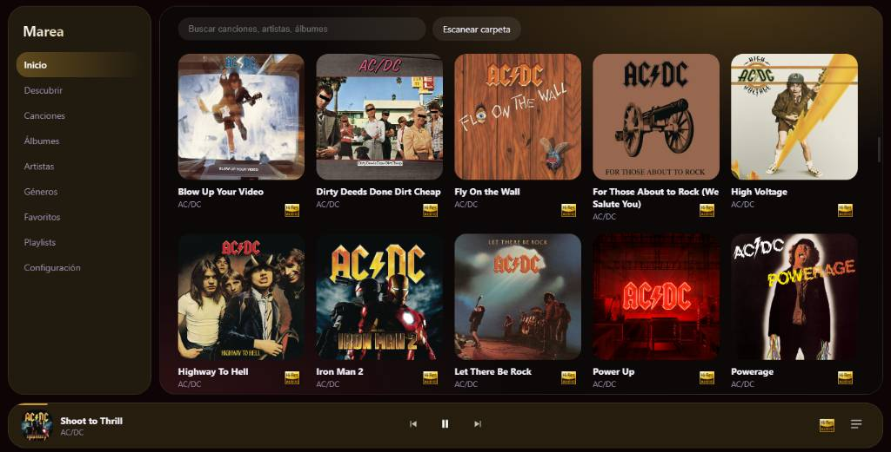
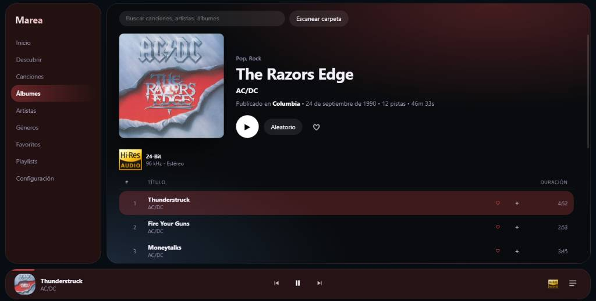
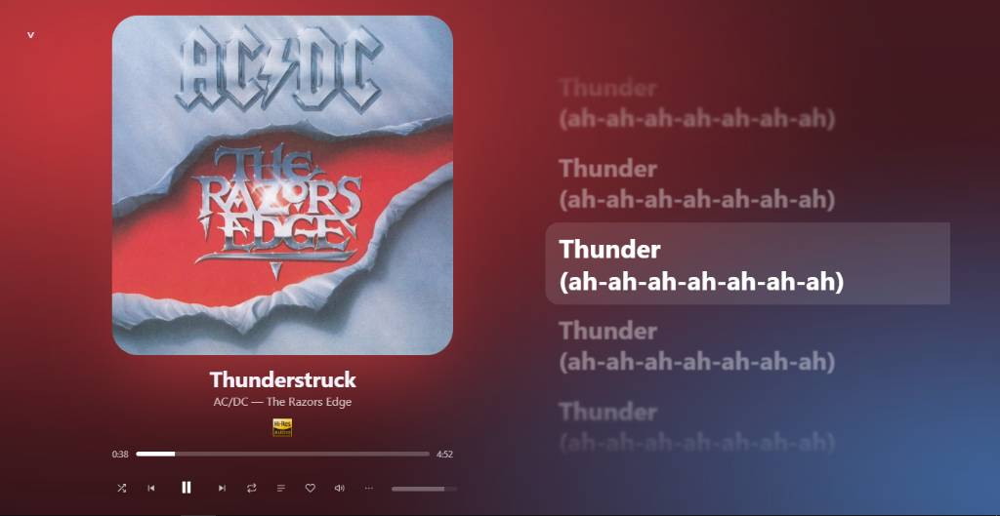

# 🌊 Marea Player

### **A lightweight, bit-perfect audio player for Windows powered by mpv.**

**`Windows 10/11`** • **`Bit-Perfect Audio`** • **`Hi-Res 24-Bit / 96kHz+`** • **`mpv Engine`**

### ➡️ [**Download Latest Release (v1.0.0)**](https://github.com)

 

---

## ✨ Why Marea?

Most audio players force you to choose between **clinical sound quality with dated interfaces** or **pretty apps that resample and alter your audio**. 

**Marea** bridges that gap: it combines the audiophile-grade **mpv** audio engine with an adaptive, artwork-driven interface designed to get out of the way and let you enjoy your music in its purest form.

---

## 🎯 Core Highlights

| Feature | Description |
| :--- | :--- |
| 🎧 **True Bit-Perfect Output** | Built on **mpv** to deliver unaltered audio directly to your DAC without digital resampling. |
| 🏅 **Auto Hi-Res Detection** | Automatically reads and displays native bit depth, sample rate (`24-Bit / 96 kHz+`), and *Hi-Res Audio* badges. |
| 🎨 **Adaptive Dynamic UI** | Interface colors subtly shift to match the dominant tones of the currently playing album cover. |
| 🎤 **Synced Lyrics Mode** | Full-screen immersive Now Playing view with real-time synchronized lyrics. |
| 📂 **Instant Local Library** | Fast folder scanning with clean organization by **Albums, Artists, Genres, Favorites, and Playlists**. |
| 🪶 **Featherweight Footprint** | Minimal CPU and RAM usage for rock-solid, stutter-free playback. |

---

## 📸 Visual Tour

<table>
  <tr>
    <td align="center"><b>Album View & Native Hi-Res Specs</b></td>
    <td align="center"><b>Immersive Now Playing & Synced Lyrics</b></td>
  </tr>
  <tr>
    <td></td>
    <td></td>
  </tr>
</table>

---

## 🎵 Supported Formats

* **Lossless:** `FLAC`, `WAV`
* **Lossy:** `MP3`

---

## 🚀 Quick Start

1. Head over to the **[Releases](https://github.com)** section on the right.
2. Download the latest **`Marea-Player`** package (`.zip` or `.exe`).
3. Extract the folder (if using the portable version) and launch **`Marea.exe`**.
4. Click **Scan Folder** (*Escanear carpeta*) to load your local music library.

---

  Crafted with passion for pure audio by <b>Sebsx669</b> • Closed-source freeware for personal use.

